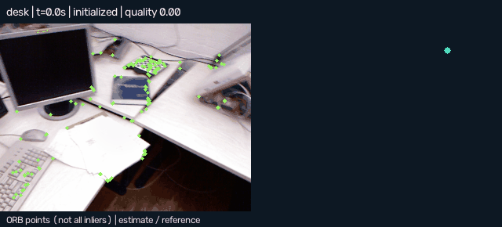
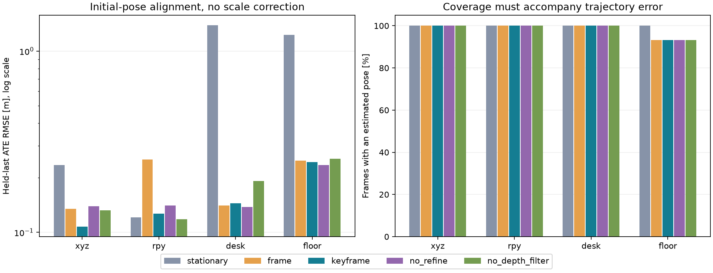
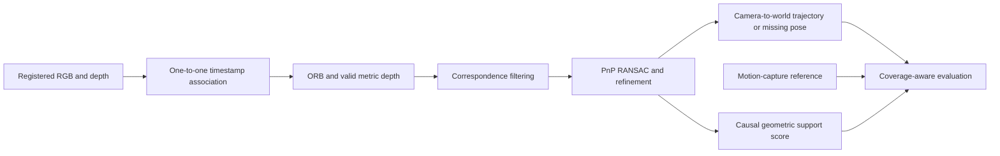

# DepthTrack

[](https://github.com/thezanis11/depthtrack/actions/workflows/checks.yml)

**CPU RGB-D visual odometry on real TUM recordings, with explicit tracking failures, geometric ablations and reproducible evaluation.**

Python · OpenCV · ORB · PnP-RANSAC · metric geometry · reliability diagnostics

DepthTrack estimates camera motion from registered color/depth images. It compares a stationary baseline, last-successful-frame odometry and keyframe odometry, then measures what refinement, depth filtering and sensor degradations change. It is a localization research prototype, not a complete SLAM or autonomous-driving system.



Visual excerpt: TUM RGB-D, Sturm et al., IROS 2012, CC BY 4.0; resized and annotated by DepthTrack. The displayed ORB points are not all PnP inliers.

## Inspect the measured results

- [Portable interactive report](reports/index.html): download the repository and open this file locally.
- [Measured findings in French](reports/RESULTS_FR.md).
- [All metrics](reports/metrics.csv), [tracked-only warning analysis](reports/diagnostic_tracked_only.csv), and [experiment manifest](reports/experiment.json).
- [Frozen calibration](reports/calibration.json) and [protocol](docs/METHOD.md).

The full campaign contains **44 runs** on four complete sequences: five clean comparison methods, four perturbations and two additional depth-mask seeds per sequence. RGB/depth matching may exclude unmatched input frames; counts are reported. All retained observations are processed; there is no unreported random frame subsampling.



The results deliberately retain failures and cases where added complexity does not help. A small error on the surviving part of a trajectory is not sufficient: output coverage, lost intervals and an evaluation-only held-last penalty are reported alongside ATE and 0.5-second RPE. Neither alignment fits scale.

On the reserved clean desk/floor sequences, keyframe held-last ATE is approximately **0.144 m / 0.244 m**, with **100% / 93.2%** pose coverage. Frame-to-frame is slightly better on desk (0.141 m). The clean desk tracked-only warning recall is only about **10.4%** for the declared local-error label: the diagnostic is not a reliable safety monitor. Read the full results and metric definitions before comparing these values with other systems.

## Reproduce on Windows

Python 3.12+ is required by the locked numerical dependencies. Local execution uses Python 3.14, CPU only. No GPU, ROS, paid service or robot is required.

```powershell
python -m venv .venv
.\.venv\Scripts\python.exe -m pip install --require-hashes --only-binary=:all: -r requirements-lock.txt
.\.venv\Scripts\python.exe -m unittest discover -s tests -v
.\.venv\Scripts\python.exe scripts/download_data.py
.\.venv\Scripts\python.exe -m depthtrack.cli benchmark
.\.venv\Scripts\python.exe scripts/analyze_results.py
.\.venv\Scripts\python.exe scripts/check_report.py
```

The benchmark uses the committed validation-selected configuration. Feature/run caches are created on demand and verified on reuse. On Linux/macOS replace `.venv\Scripts\python.exe` with `.venv/bin/python`.

To explicitly repeat parameter selection, run `python -m depthtrack.cli calibrate` before benchmarking. This reads only xyz/rpy. If core code changes, benchmarking requires explicit recalibration. Do not use previously observed desk/floor results to tune parameters while claiming those sequences remain unseen.

A smaller real-data smoke experiment:

```powershell
.\.venv\Scripts\python.exe scripts/download_data.py --sequences xyz
.\.venv\Scripts\python.exe -m depthtrack.cli smoke --sequences xyz --out data/smoke
```

For an immediate five-minute demonstration, the committed HTML report replays the measured trajectories without raw datasets or Python. [French demonstration guide](docs/DEMO_FR.md).

## Data, resources and timing

Official archives total about **1.94 GB**. Keep roughly **5 GB** available for archives, extracted PNGs, caches and the environment, plus working headroom. The downloader stops before consuming its free-space reserve. It retains archives for integrity verification and never deletes other project data.

Data are the real TUM RGB-D Freiburg 1 `xyz`, `rpy`, `desk` and `floor` sequences. xyz is development, rpy validation, desk/floor evaluation. Missing-depth masks, frame skipping and 100 ms depth lag are synthetic perturbations of these real observations.

Feature extraction and pose tracking are timed separately. Tracking-only latency excludes image I/O and ORB, so it is not an end-to-end real-time claim. OpenCV uses one thread and the application processes one sequence at a time. Duration depends on CPU and cache reuse; original measured per-frame times are retained in cached results.

## Architecture



The ground-truth trajectory never enters the tracker or feature cache. Its only roles are validation selection and retrospective evaluation. Synthetic tests check transformation conventions and known camera motion independently of the real-data trajectory reference.

## Important limitations

- No loop closure, global map optimization, place-recognition relocalization or IMU fusion.
- The TUM-recommended ROS-default calibration for pre-registered depth is an approximation, not a newly estimated calibration.
- The quality score measures current geometric support. It is not a probability or a proven early-warning signal. Tracked-only diagnostics exclude already-declared losses to expose this limitation.
- Four recordings from one indoor camera/domain do not establish outdoor, automotive or cross-sensor performance. Perturbation seeds and adjacent frames are not independent physical trials.
- Stationary output has 100% availability by construction; that does not mean it tracks motion correctly.
- Initial-pose alignment and least-squares rigid alignment are both reported and can differ materially. No scale correction is used.

## Files and learning

`depthtrack/`: data adapters, geometry, features, tracker, evaluation and reports. `scripts/`: acquisition, dependency provenance, result analysis and integrity checks. `reports/traces/`: compressed derived trajectories. Raw data, caches and environments are excluded from Git.

[Learning guide in French](docs/GUIDE_FR.md) · [Method](docs/METHOD.md) · [Dataset provenance](docs/DATASET_MANIFEST.json) · [Third-party notices](THIRD-PARTY-NOTICES.md)

Developed with AI assistance. The learning guide identifies exercises to understand, modify and defend personally; no industrial deployment or professional experience is claimed.

Code: [MIT](LICENSE). TUM data and derived visual excerpts: **CC BY 4.0**, attribution to Jürgen Sturm, Nikolas Engelhard, Felix Endres, Wolfram Burgard and Daniel Cremers, *A Benchmark for the Evaluation of RGB-D SLAM Systems*, IROS 2012. [Official benchmark](https://cvg.cit.tum.de/data/datasets/rgbd-dataset).
